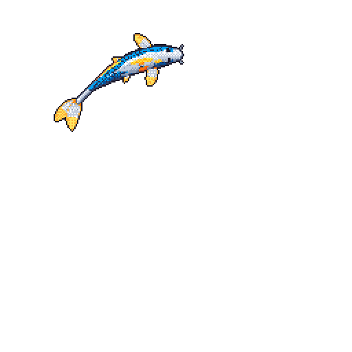

<table>
  <tr>
    <td width="72%" valign="middle">
      <h2>Hi, I'm Dida</h2>
      
Student learning by building and figuring things out along the way.

      <ul>
        <li>Software developer focused on backend and system-level work</li>
        <li>Currently learning Go</li>
        <li>Building projects around backend and infrastructure</li>
      </ul>
      
Feel free to explore my repositories.

    </td>
    <td width="28%" align="center" valign="middle">
      
       
      <samp>git-koi activity</samp>
    </td>
  </tr>
</table>
